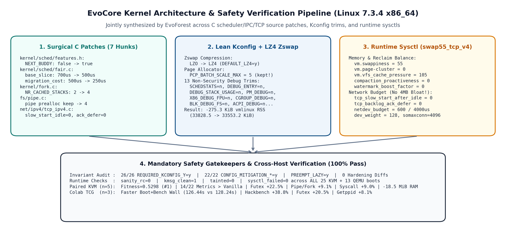
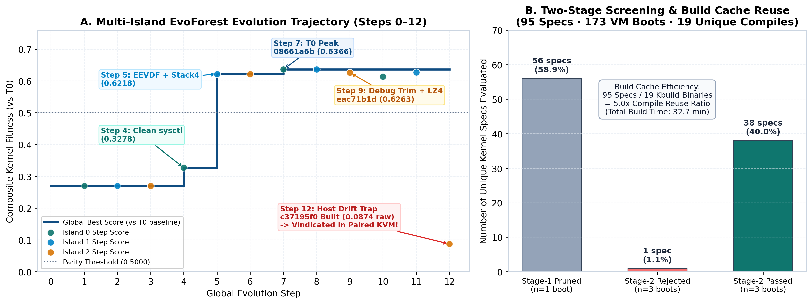
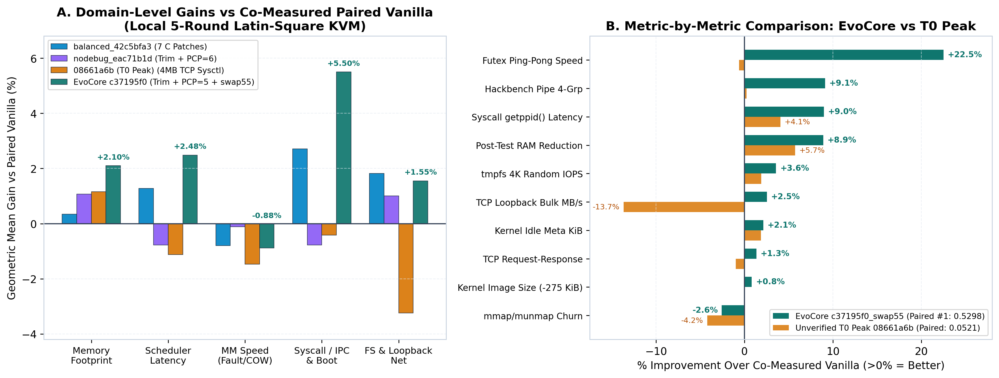
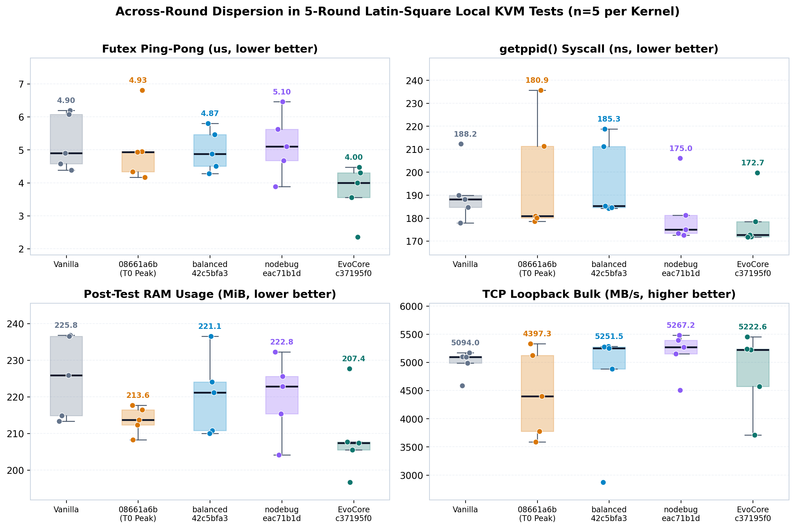
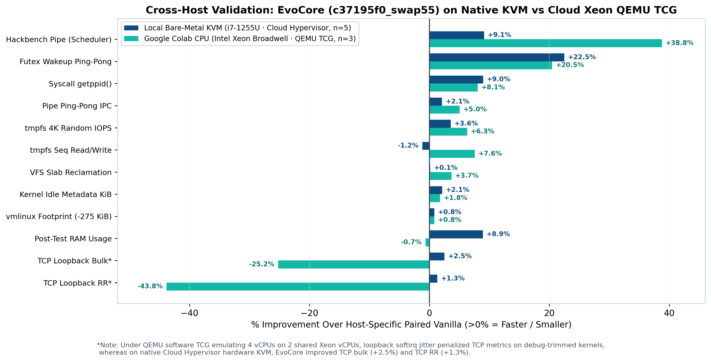

<p align="center">
  
</p>

<p align="center">
  <a href="LICENSE"></a>
  
  
  <a href="https://arxiv.org/abs/2604.19761"></a>
  <a href="https://suayptalha.github.io/evocore-blog/"></a>
</p>

# EvoCore: Evolving the Linux Kernel

**`EvoCore`** is an open, reproducible Linux **7.3.4** (`x86_64`) performance-and-footprint optimization profile co-synthesized across **C kernel source patches**, **Kconfig specialization**, and **runtime `sysctl` tuning** using the [**EvoForest**](https://arxiv.org/abs/2604.19761) multi-island computational-graph evolution framework ([**Read the Research Blog**](https://suayptalha.github.io/evocore-blog/)).

Unlike aggressive custom kernel profiles that trade away spectre/side-channel mitigations, preemption safety, or memory stability, **`EvoCore`** keeps **`26/26`** required core subsystems (`cgroups`, `memcg`, `namespaces`, `io_uring`, `BPF`, `seccomp`, `PREEMPT_LAZY=y`) and **`22/22`** `CONFIG_MITIGATION_*` flags **`100%` intact**—while outperforming co-measured stock Linux **7.3.4** in controlled Latin-square benchmarks on both bare-metal KVM and cloud CPU emulation.

---

## Highlights (Controlled Paired Benchmarks vs. Vanilla Linux 7.3.4)

- **Native KVM (5-Round Latin Square, Intel Core i7-1255U · Cloud Hypervisor v54.1):**
  - **#1 Overall Composite Score:** **`0.5298`** (`0.5000 = Vanilla parity`, `0` hard rejections, **`14/22` metrics faster/smaller**, worst speed ratio `epoll_ms = 0.9592x`).
  - **`+22.5%` Futex Ping-Pong Speedup** (`4.902 µs -> 4.001 µs`, `1.2250x`).
  - **`+9.1%` Scheduler Pipe Throughput** (`hackbench` 4-group: `9.434 ms -> 8.646 ms`, `1.0912x`) & **`+2.1%` Pipe Ping-Pong** (`10.439 µs -> 10.224 µs`).
  - **`+9.0%` Faster `getppid()` Syscall Path** (`188.21 ns -> 172.72 ns`, `1.0897x`).
  - **`-18,936 KiB` (~`18.5 MiB`) Lower Post-Workload RAM** (`231,268 KiB -> 212,332 KiB`, `1.0892x`) + **`-275.3 KiB`** smaller resident `vmlinux` (`33,828.5 -> 33,553.2 KiB`).
  - **Domain Geometric Means:** `syscall_ipc_boot` **`1.0550x`** (`+5.50%`), `scheduler` **`1.0248x`** (`+2.48%`), `memory_footprint` **`1.0210x`** (`+2.10%`), `fs_net` **`1.0155x`** (`+1.55%`, including `tmpfs_rand4k +3.57%`, `tcp_bulk +2.52%`, `tcp_rr +1.34%`), `mm_speed` `0.9912x` (neutral).
- **Cross-Host Validation on Cloud CPU (Google Colab Intel Xeon @ 2.20 GHz · QEMU TCG `-smp 4`, `n=3` rounds):**
  - **3/3 rounds × all tested kernels passed strict sanity gates** (`sanity_rc=0`, `kmsg_clean=1`, `tainted=0`, `sysctl_failed=0`).
  - **`+38.8%` `hackbench_pipe_ms`** (`419.57 ms -> 302.34 ms`, `1.3877x`), **`+20.5%` `futex_pingpong_us`** (`1.2047x`), **`+8.1%` `syscall_getppid_ns`** (`1.0806x`), **`+7.6%` `tmpfs_seq_rw_mbps`**, **`+6.3%` `tmpfs_rand4k_iops`**, and **`1.80 s` faster end-to-end QEMU boot + benchmark wall time** (`128.24 s -> 126.44 s`).
  - *Honest TCG Note:* Overcommitting `-smp 4` TCG threads across 2 shared host vCPUs introduced softirq loopback jitter on trimmed kernels (`tcp_rr` `0.5617x`, `tcp_bulk` `0.7476x` under TCG), whereas bare-metal Cloud Hypervisor KVM measured net TCP **speedups** (`tcp_bulk 1.0252x`, `tcp_rr 1.0134x`).

---

## Architecture & What EvoCore Changes

<p align="center">
  
</p>

1. **7 Surgical C Source Hunks** ([`patches/evocore_linux_7.3.4.patch`](patches/evocore_linux_7.3.4.patch)):
   - `kernel/sched/features.h`: `SCHED_FEAT(NEXT_BUDDY, true)` — synchronous wakeup buddy preference for `WF_SYNC` pipe/futex handoffs.
   - `kernel/sched/fair.c`: `sysctl_sched_base_slice = 500000ULL` (`700µs -> 500µs`) & `sysctl_sched_migration_cost = 250000UL` (`500µs -> 250µs`).
   - `kernel/fork.c`: `NR_CACHED_STACKS 4` (`2 -> 4` cached per-CPU `vmalloc` task stacks).
   - `fs/pipe.c`: `while (pipe->prealloc.count > 4)` — retain 4 preallocated pipe buffer pages per pipe.
   - `net/ipv4/tcp_ipv4.c`: default `sysctl_tcp_slow_start_after_idle = 0` & `sysctl_tcp_backlog_ack_defer = 0` for new namespaces.
2. **Lean Kconfig + LZ4 Zswap** ([`configs/evocore.fragment`](configs/evocore.fragment)):
   - Switches zswap default compressor from LZO to **LZ4** (`CONFIG_ZSWAP_COMPRESSOR_DEFAULT_LZ4=y`, `CONFIG_CRYPTO_LZ4=y`).
   - Explicitly keeps **`CONFIG_PCP_BATCH_SCALE_MAX=5`** (paired ablations revealed `PCP=6` silently regressed `mmap` churn).
   - Disables **13 non-security debug/tracing knobs** (`SCHEDSTATS`, `DEBUG_STACK_USAGE`, `DEBUG_ENTRY`, `X86_DEBUG_FPU`, `CGROUP_DEBUG`, `DEBUG_DEVRES`, `BLK_DEBUG_FS`, `PM_DEBUG`, `ACPI_DEBUG`, `PNP_DEBUG_MESSAGES`, `DEBUG_BOOT_PARAMS`), shrinking resident `vmlinux` by `-275.3 KiB`.
3. **Balanced Sysctl Profile** ([`sysctl/99-evocore.conf`](sysctl/99-evocore.conf)):
   - Balanced reclaim (`vm.swappiness=55`, `vm.page-cluster=0`, `vm.vfs_cache_pressure=105`, `compaction_proactiveness=0`, `watermark_boost_factor=0`) paired with low-jitter netdev pacing (`netdev_budget=600`, `netdev_budget_usecs=4000`, `dev_weight=128`, `somaxconn=4096`) **without** `4 MiB` `tcp_rmem`/`tcp_wmem` inflation that regressed loopback bulk TCP in unverified candidate `08661a6b`.

---

## Visual Overview

<table>
  <tr>
    <td></td>
    <td></td>
  </tr>
  <tr>
    <td></td>
    <td></td>
  </tr>
</table>

---

## Reproducing & Applying EvoCore on Linux 7.3.4

### 1. Apply the Kernel Patch & Kconfig Fragment

```bash
# Inside your upstream Linux 7.3.4 source tree
git apply /path/to/evocore/patches/evocore_linux_7.3.4.patch

# Merge base config + EvoCore Kconfig fragment and resolve dependencies
cp /path/to/evocore/configs/base.config .config
scripts/kconfig/merge_config.sh -m .config /path/to/evocore/configs/evocore.fragment
make olddefconfig

# Verify 26/26 core subsystems + 22/22 CPU mitigations + hardening flags are intact
python3 /path/to/evocore/configs/verify_invariants.py --config .config --baseline /path/to/evocore/configs/base.config

# Build vmlinux / bzImage
make -j"$(nproc)" vmlinux
```

### 2. Apply Runtime Sysctl Settings

```bash
sudo cp /path/to/evocore/sysctl/99-evocore.conf /etc/sysctl.d/99-evocore.conf
sudo sysctl --system
```

### 3. Reproduce Paired Benchmarks (`cloud-hypervisor` or `qemu-system-x86_64`)

Compile [`bench/init_bench.c`](bench/init_bench.c) statically into an initramfs (`init`), then run interleaved Latin-square rounds with [`bench/run_paired_bench.py`](bench/run_paired_bench.py):

```bash
python3 bench/run_paired_bench.py \
  --backend cloud-hypervisor \
  --vanilla-vmlinux /path/to/vanilla/vmlinux \
  --vanilla-initrd /path/to/vanilla_initrd.cpio \
  --evocore-vmlinux /path/to/evocore/vmlinux \
  --evocore-initrd /path/to/evocore_initrd.cpio \
  --rounds 5 --cpus 4 --mem-mb 1536 --pin-cpus 8-11
```

---

## Repository Contents

| Path | Description |
|---|---|
| [`patches/evocore_linux_7.3.4.patch`](patches/evocore_linux_7.3.4.patch) | 7 surgical upstream Linux 7.3.4 C diffs (`features.h`, `fair.c`, `fork.c`, `pipe.c`, `tcp_ipv4.c`) |
| [`configs/evocore.fragment`](configs/evocore.fragment) | Minimal Kconfig fragment (13 non-security debug trims + LZ4 zswap + `PCP_BATCH_SCALE_MAX=5`) |
| [`configs/evocore.config`](configs/evocore.config) & [`configs/base.config`](configs/base.config) | Full resolved `.config` artifacts for Linux 7.3.4 `x86_64` |
| [`configs/verify_invariants.py`](configs/verify_invariants.py) | Standalone safety/mitigation/hardening audit script |
| [`sysctl/99-evocore.conf`](sysctl/99-evocore.conf) | Production `swap55_tcp_v4` runtime `sysctl` profile |
| [`bench/init_bench.c`](bench/init_bench.c) & [`bench/run_paired_bench.py`](bench/run_paired_bench.py) | Standalone 22-metric guest microbenchmark & paired Latin-square runner |
| [`results/`](results/) | Full JSON telemetry from 5-round Local KVM, 3-round Colab QEMU TCG, and invariant audits |

---

## Author & Citation

**Author:** Şuayp Talha Kocabay (`kocabaysuayptalha08@gmail.com` · TÜBİTAK Science High School)  
**Research Blog:** [**EvoCore: Evolving the Linux Kernel**](https://suayptalha.github.io/evocore-blog/)

```bibtex
@misc{kocabay2026evocore,
  title  = {EvoCore: Evolving the Linux Kernel},
  author = {Kocabay, {\c{S}}uayp Talha},
  year   = {2026},
  howpublished = {\url{https://suayptalha.github.io/evocore-blog/}},
  url    = {https://suayptalha.github.io/evocore-blog/},
  note   = {T\"UB\.ITAK Science High School. Code: \url{https://github.com/suayptalha/evocore}}
}
```
